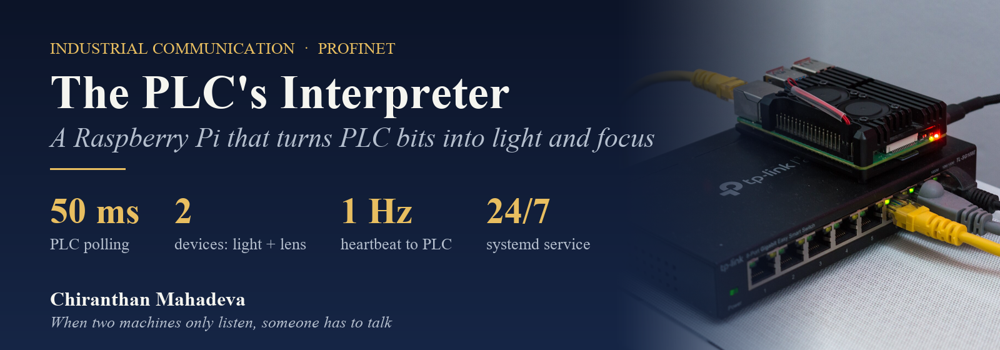
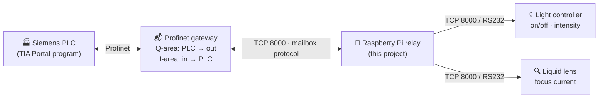
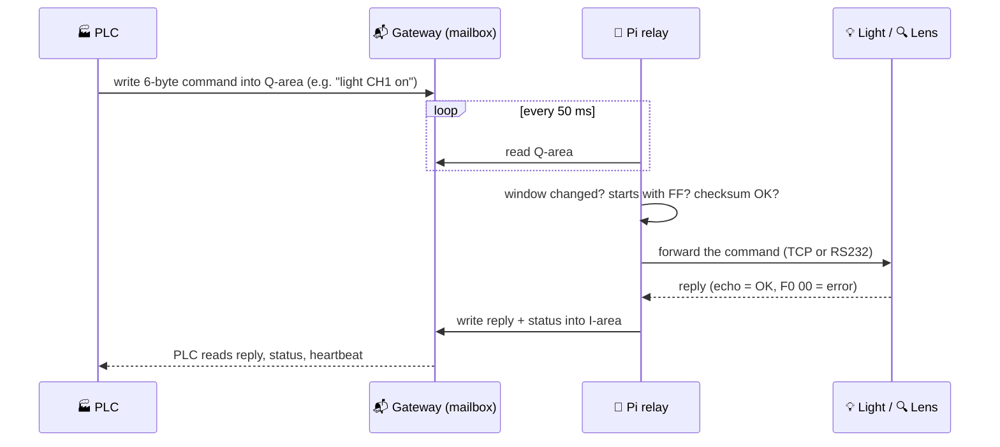

  

  
  
  
  

  <b>A small relay on a Raspberry Pi that lets a Siemens PLC switch and dim the inspection lighting 
  and refocus a liquid lens, through a Profinet gateway that can't do it on its own.</b>

> **Source code is private.** It was built for an industrial customer project. This page explains the problem, *how* such a relay works and what I learned. No client names are used.

---

## 🤔 New to this? The 60-second version

**What is a PLC?**
The industrial computer that runs a machine. In this project it decides **when the light goes on, how bright it is, and where the camera lens focuses** for each product.

**What is Profinet?**
*Profinet* is the **industrial Ethernet** that Siemens PLCs use to talk to their devices (drives, sensors, I/O). It's fast and deterministic, but a device has to *speak Profinet* to join in.

**The problem**
The light controller and the liquid lens speak a simple **byte protocol over TCP or RS232**, not Profinet. A **Profinet gateway module** was added to bridge the gap. During commissioning it turned out that the gateway is **not a bridge at all**:

| What we expected | What the gateway actually is |
|---|---|
| A translator that forwards PLC commands to the light | A **passive 200-byte mailbox**: the PLC can drop bytes in, but nothing is sent onwards |

And the light controller and lens are **pure listeners**: they only answer when spoken to.
**Two devices that only listen will never talk to each other.**

**What did I build?**
An **active relay in the middle**: a small program that keeps reading the PLC's mailbox, translates each command for the right device, sends it, and writes the device's answer back to the PLC. It runs headless on a **Raspberry Pi** inside the cabinet.

> Think of it like two people who only answer questions, plus an **interpreter** who keeps asking both and passes the answers along.

---

## 🏭 The pipeline end to end

### One command, step by step

## 📨 The contract with the PLC programmer

The key to working with automation engineers is a **clear byte contract**. Each device gets its own small window in the mailbox:

**Command window (PLC → device), 6 bytes**

| Byte | Meaning |
|:--:|---|
| 0 | `FF` start marker (otherwise the frame is ignored) |
| 1 | command: light *on/off* or *intensity*, lens *set current* |
| 2 | channel: 1, 2 or all |
| 3–4 | value (high / low byte) |
| 5 | XOR checksum |

**Answer window (device → PLC), 4 bytes**

| Byte | Meaning |
|:--:|---|
| 0–1 | the device's reply |
| 2 | **status**: `0` ok · `1` link error · `2` device error · `4` no reply |
| 3 | **heartbeat**: counts up about once per second while the relay is alive |

- **All zeros = idle.** A command is sent **only when the window changes**, so the PLC never floods the device.
- To repeat the same command, the PLC writes zeros in between, which is simple and deterministic.
- The **heartbeat** lets the PLC detect a dead relay on its own and raise an alarm.

## 🍓 Running it on a Raspberry Pi, 24/7

| Concern | Solution |
|---|---|
| **Start without anyone logging in** | Runs as a **systemd service**: starts at boot, **restarts automatically after 3 s** if anything fails |
| **"Is it working?" without a screen** | The Pi's green **status LED blinks at 1 Hz while connected** to the gateway, and goes back to normal when not. A technician can check it by looking at the cabinet. |
| **Two networks** | Wi-Fi for remote maintenance (SSH), plus a separate **wired machine network with a static IP** for the PLC devices, with no router and no DHCP |
| **Lost connections** | Every link reconnects on its own, with rate-limited retries per device |
| **Diagnostics** | Built-in tools: **UDP device discovery**, read or **monitor** the PLC mailbox live, write test bytes, clear the answer area |
| **Same commands, different cables** | Identical frames over **Ethernet or RS232**: switching transport needs **no PLC change** |

## 🔁 How it evolved

| Version | Platform | What it does |
|---|---|---|
| v1 | Windows PC | Gateway client library + relay for **one light controller over RS232**. Proved the mailbox concept end to end. |
| v2 | Windows industrial PC | **Light + liquid lens**, two serial ports, one gateway connection, status and heartbeat for each device |
| v3 | **Raspberry Pi** | Both devices over **Ethernet**, systemd service, LED health signal, persistent network setup |

## ⚠️ What commissioning taught me

1. **Read the manual twice and test once.** The "Profinet communication module" sounded like a bridge, but the manual showed a **passive mailbox**. Recognising that early saved days of looking for a missing setting.
2. **Check both ends: are they talkers or listeners?** If both sides only answer, you need an active party in the middle.
3. **Discard the greeting.** The gateway sends an identity banner as soon as a TCP client connects. Unless it's discarded, it corrupts the first real reply.
4. **One client at a time.** The gateway and devices accept a **single TCP connection**. Debug tools must stop the relay first, and two relays must never run at once.
5. **Static IPs must be saved, not just set.** On the Pi a manually added IP vanished after a reboot. The fix was a **saved NetworkManager profile** (`ipv4.method manual`). A machine network without DHCP doesn't forgive this.
6. **Give the PLC a heartbeat.** A counter that keeps changing is the simplest way for a PLC to know its partner is alive.
7. **Brightness 0 isn't "off".** On/off and intensity are independent commands, and the PLC program has to treat them that way.

## ✅ Status

- Commissioned with a **Siemens PLC** (TIA Portal) over Profinet and **verified on the machine end to end**: the light channels switch and dim, the liquid lens refocuses, and replies, status and heartbeat reach the PLC.
- Running as a headless **Raspberry Pi 4** service with automatic restart.

## 🧰 Tech stack

**Python 3** (standard-library sockets + `pyserial`) · **Profinet** gateway mailbox protocol · TCP and **RS232** device links · UDP discovery · **Raspberry Pi 4** (Debian, NetworkManager) · **systemd** · Siemens **TIA Portal** (PLC side)

## 🔗 Related

- **[OPCUA-PLCVisionBridge](https://github.com/Gojoinferno/OPCUA-PLCVisionBridge)**: vision results written into the PLC over OPC UA.
- **[RESTAPI-VisionGateway](https://github.com/Gojoinferno/RESTAPI-VisionGateway)**: the plant control system triggering vision measurements over REST.

---

  <b>Chiranthan Mahadeva</b> · Industrial machine vision & automation 
  More: <a href="https://github.com/Gojoinferno/Realtime-DigitOCR">Realtime-DigitOCR</a> ·
  <a href="https://github.com/Gojoinferno/MachineVision-Research">MachineVision-Research</a>

Banner photo: "Raspberry Pi 4 on a network switch" by RAIL P (RAIL.PHOTOGRAPHY), <a href="https://commons.wikimedia.org/wiki/File:Raspberry_Pi_4_on_a_network_switch.jpg">Wikimedia Commons</a>, CC0.
